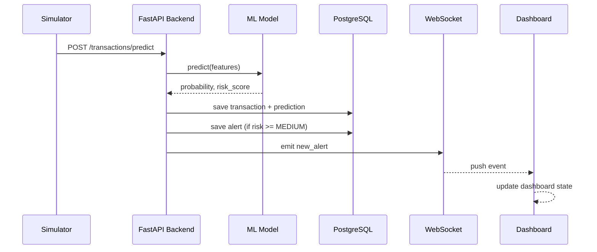
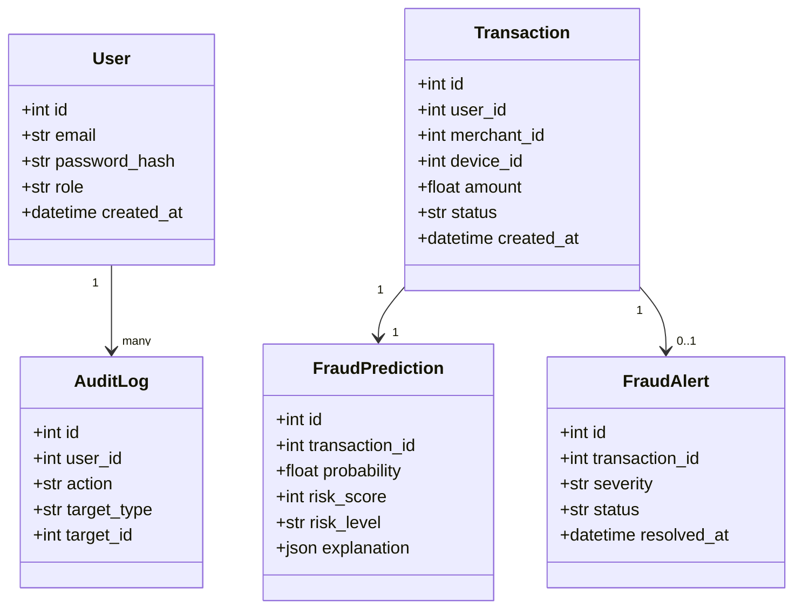
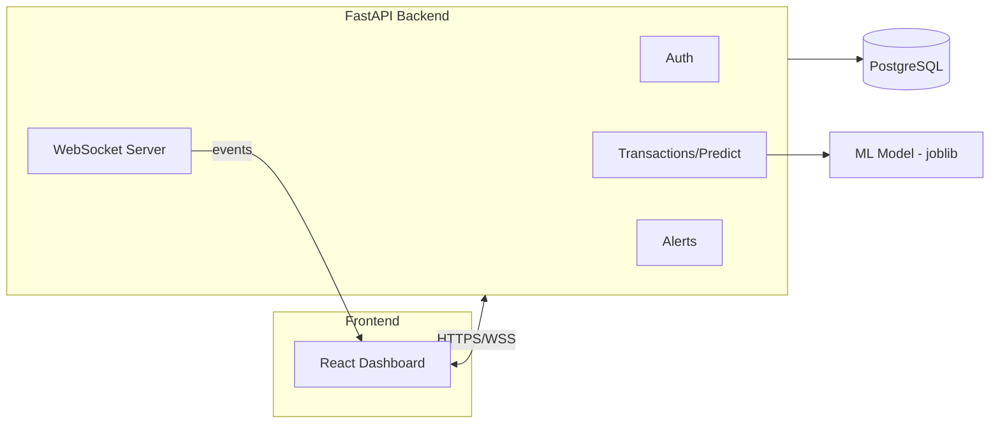
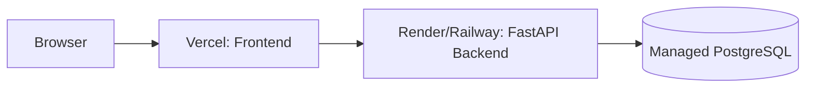
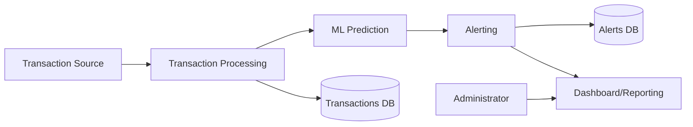

# UML & Data Flow Diagrams (Week 17)

## Use Case Diagram (actors & use cases)
Actors: **Admin, Analyst, User (viewer), Transaction Simulator**
Use cases: Login, View Dashboard, Investigate Transaction, Resolve Alert, Manage Users, Export Report, View Audit Log.

## Sequence Diagram (Mermaid — transaction → prediction → alert → WebSocket → dashboard)



## Class Diagram (SQLAlchemy models, mirrors PART 11 / `backend/app/models/`)



## Activity Diagram (Decision Engine branching)

```mermaid
flowchart TD
    A[fraud_probability] --> B[risk_score = round(prob*100)]
    B --> C{risk_score range}
    C -->|0-29| D[LOW: Allow]
    C -->|30-59| E[MEDIUM: Monitor + alert]
    C -->|60-79| F[HIGH: Flag + alert]
    C -->|80-100| G[CRITICAL: Critical Alert]
```

## Component Diagram



## Deployment Diagram



## Data Flow Diagram — Level 1


